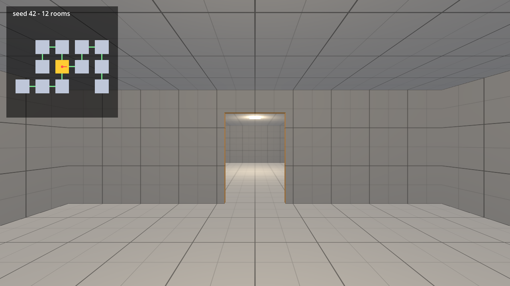

# Dungeon Generator in Godot 4

Project files for tutorial 02 of the Godot 4 series by Phaix on YouTube (https://www.youtube.com/@Phaix).

Generate a branching dungeon on a grid in Godot 4: one graybox room scene, a seeded layout that grows like a plant, doors only where rooms connect, a first person player and a debug map. Same seed, same dungeon. Every step is its own project folder.



## Steps

Every step of the video is its own folder in `steps/`, the exact state at the end of that
part. Open the project in Godot 4.7, then open `steps/<step>/main.tscn` and press F6 to run
that step. The project's main scene is the final step.

| Folder | Part of the video |
|---|---|
| `steps/step_01_one_room` | Step 1 - One room |
| `steps/step_02_room_grid` | Step 2 - A grid of rooms |
| `steps/step_03_seeded_layout` | Step 3 - A seeded layout |
| `steps/step_04_doors` | Step 4 - Doors |
| `steps/step_05_walking_player` | Step 5 - A player that walks |
| `steps/step_06_mouse_look` | Step 6 - Mouse look |
| `steps/step_07_debug_map` | Step 7 - Debug map |

## Controls

WASD or arrow keys or the left stick to walk, mouse or right stick to look, Space to jump,
Esc gives the mouse back, a click captures it again. Further keys per tutorial are shown
in the video and in the HUD.

## Tests

```sh
godot --headless --path . -s res://tests/run_tests.gd
```

## License

Code and scenes: MIT (see LICENSE).
